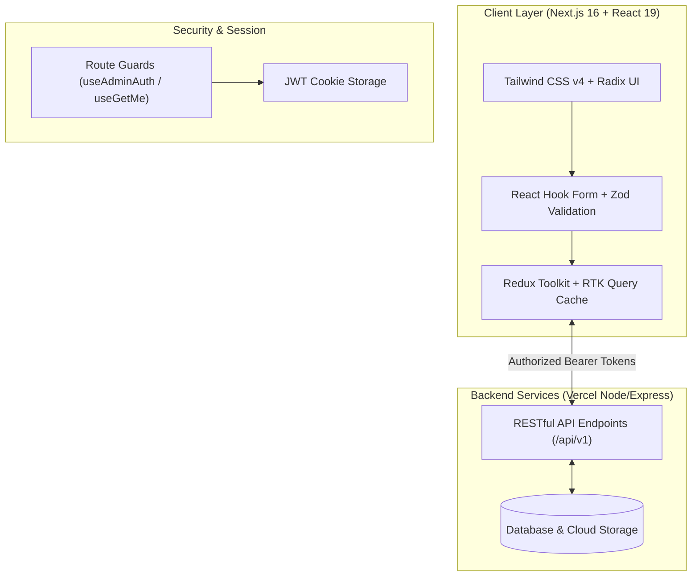

<div align="center">

  # 🚀 SkillShelf — Digital Marketplace & LMS Platform
  
  **Learn · Watch · Grow — A Full-Stack Digital Product Storefront, E-Learning Hub & Multi-Tier Management Platform**

  [](https://nextjs.org/)
  [](https://react.dev/)
  [](https://www.typescriptlang.org/)
  [](https://tailwindcss.com/)
  [](https://redux-toolkit.js.org/)
  [](#license)

  <br />

  [🌐 Live Demo](https://skill-shelf-frontend.vercel.app) • [🔌 Backend API](https://skill-shelf-backend.vercel.app/api/v1/) • [🐛 Report Bug](https://github.com) • [✨ Request Feature](https://github.com)

</div>

---

## 📖 Executive Overview

**SkillShelf** is an enterprise-ready, high-performance digital marketplace and Learning Management System (LMS) built with the bleeding-edge React 19 and Next.js 16 ecosystem. 

Designed to bridge the gap between premium content delivery and seamless e-commerce, SkillShelf empowers creators to distribute **digital software tools, interactive video courses, SEO toolkits, and curated product bundles**, while providing buyers with a smooth checkout experience and an intuitive learning space.

The platform includes a dedicated **Admin Operations Dashboard** for high-level business intelligence, inventory curation, order handling, user role governance, and affiliate commission management, alongside a personalized **User Learning Hub**.

---

## 🌟 Key Highlights & Engineering Strengths

- **⚡ Next.js 16 App Router & React 19:** Leverages route groups `(auth)`, `(commonLayout)`, and `(dashboard)`, nested layouts, parallel loading states, and granular suspense boundaries.
- **🔄 Scalable State & RTK Query Architecture:** Centralized Redux Toolkit store with tag-based cache invalidation (`tagTypes`), memory-efficient query deduplication (5-minute caching lifecycle), and debounced asynchronous search.
- **🛡️ Multi-Role RBAC & Secure Auth:** Role-based access control protecting Admin and Customer routes with JWT verification, persistent cookies, OTP email verification, and secure password reset workflows.
- **🛍️ Complete E-Commerce Pipeline:** Dynamic shopping cart with real-time tax/discount computation, promotional coupon engine, and instant checkout.
- **🤝 Affiliate Marketing Ecosystem:** End-to-end partner link generation, performance metrics tracking, and commission management.
- **📊 Interactive Analytics & Management Portals:** Detailed KPI analytics cards, searchable/sortable data tables, modal dialogs, and dynamic status workflows.
- **🎨 Modern Design System:** Built using Tailwind CSS v4, Lucide icons, custom responsive layout primitives, and polished micro-animations for an ultra-responsive UI.

---

## 🎯 Core Features Breakdown

### 🛒 1. Public Storefront & Discovery
- **Hero & Trust Badges:** High-converting landing view featuring product highlights, social proof counters, and partner branding.
- **Course & Product Catalog:** Filterable marketplace for courses, downloadable assets, and specialized toolkits.
- **VIP Bundles & SEO Toolkits:** Curated collections allowing bulk purchases at dynamic discount rates.
- **Dynamic Cart Experience:** Local and server-synced cart drawer/page supporting coupon redemption, instant quantity recalculation, and order review.
- **Flexible Pricing & Subscriptions:** Tiered membership options for continuous course library access.

### 🎓 2. Learner & Customer Portal (`/user-dashboard`)
- **Learning Hub (`/my-courses`):** Quick-access classroom view tracking enrolled courses and progress.
- **Download Vault (`/downloads`):** Immediate access to purchased digital assets, zip packages, and documentation.
- **Order History & Invoices (`/my-orders`):** Comprehensive log of historical purchases with invoice viewing and receipt details.
- **Membership Status (`/membership`):** Real-time monitoring of current subscription tiers, renewal dates, and upgrade perks.
- **Affiliate Center (`/affiliate`):** Referral link generator, tracking clicks, successful referrals, and commission payouts.
- **Feedback & Reviews (`/my-reviews`):** Manage published course reviews and product ratings.

### 🛠️ 3. Admin Command Center (`/admin-dashboard`)
- **Executive KPI Dashboard:** Real-time metrics tracking gross revenue, total active customers, orders count, and conversion trends.
- **Product & Course Management:** Full CRUD operations for digital assets, courses, curriculum modules, and media assets.
- **Bundle & Category Taxonomy:** Organize inventory into custom categories and promotional combo bundles.
- **Order Management & Fulfillment:** Multi-status order tracker (Pending, Processing, Completed, Cancelled) with customer lookup and debounced search.
- **Coupons & Discount Engine:** Create and schedule percentage-based or flat discount codes with usage limits.
- **User Directory & Roles:** Customer and staff account governance with instant role updates and access toggles.
- **Affiliate Governance:** Review and approve affiliate applications and track global payouts.

---

## 🏗️ Architecture & Data Flow



---

## 💻 Tech Stack & Tooling

| Domain | Technology / Library | Description |
|---|---|---|
| **Framework** | [Next.js 16.4.0](https://nextjs.org/) | App Router, Server/Client components, optimized builds |
| **Library** | [React 19.3.0](https://react.dev/) | Concurrent rendering, latest hooks & server actions support |
| **Language** | [TypeScript 5](https://www.typescriptlang.org/) | Strict static typing across entire client & API interfaces |
| **State Management** | [Redux Toolkit (RTK)](https://redux-toolkit.js.org/) | Centralized state, slice reducers & Redux Persist |
| **API Client** | [RTK Query](https://redux-toolkit.js.org/rtk-query/overview) | Normalized caching, optimistic updates, tag invalidation |
| **Styling** | [Tailwind CSS v4](https://tailwindcss.com/) | Next-generation utility-first styling with modern CSS variables |
| **UI Components** | [Radix UI](https://www.radix-ui.com/) & Base UI | Accessible unstyled primitives for dialogs, popovers, and menus |
| **Icons** | [Lucide React](https://lucide.dev/) & React Icons | Crisp, modern vector icon sets |
| **Form Handling** | [React Hook Form](https://react-hook-form.com/) | High-performance, lightweight form state manager |
| **Validation** | [Zod](https://zod.dev/) | Type-safe schema validation |
| **Notifications** | [Sonner](https://sonner.emilkowal.ski/) | Opinionated, animated toast notification component |
| **Utilities** | Date-fns, js-cookie, jwt-decode | Token parsing, session handling, date formatting |
| **Document Export** | jsPDF & XLSX | Client-side report generation & spreadsheet downloads |

---

## 📂 Project Directory Structure

```plaintext
src/
├── app/                              # Next.js App Router root
│   ├── (auth)/                       # Authentication route group
│   │   ├── signIn/                   # User & Admin login
│   │   ├── signUp/                   # Account registration
│   │   ├── forget-password/          # Credential recovery
│   │   ├── otp/                      # Two-factor/email OTP confirmation
│   │   └── reset-password/           # Password update confirmation
│   ├── (commonLayout)/               # Public storefront routes
│   │   ├── courses/                  # Course catalog & dynamic [id] view
│   │   ├── products/                 # Digital asset repository
│   │   ├── bundles/                  # Bundle curation & [id] details
│   │   ├── membership/               # Subscription pricing tiers
│   │   ├── shopping-cart/            # Checkout & cart calculation
│   │   └── affiliate/                # Partner program application
│   ├── (dashboard)/                  # Protected dashboard area
│   │   ├── admin-dashboard/          # Admin management portal
│   │   └── user-dashboard/           # Customer learning hub
│   └── layout.tsx                    # Root provider & font configuration
├── components/                       # Reusable UI component architecture
│   ├── pages/                        # Feature-specific page components
│   │   ├── adminDashboard/           # Admin modular views (orders, users, courses, etc.)
│   │   ├── userDashboard/            # Learner modular views (my-courses, downloads, etc.)
│   │   └── home/                     # Storefront landing page sections
│   ├── shared/                       # Cross-functional widgets (Navbar, Footer, Modals, Tables)
│   └── ui/                           # Atoms & base primitives (Buttons, Inputs, Badges)
├── feature/                          # Business logic modules (Auth, Verification)
├── hooks/                            # Custom React hooks (useAdminAuth, useDebounce, useGetMe)
├── redux/                            # State store & API layers
│   ├── api/                          # RTK Query API slice definitions
│   │   ├── adminDashboardApi/        # Admin data mutations & queries
│   │   ├── userDashboardApi/         # User profile, orders, and library queries
│   │   └── baseApi.ts                # Shared baseUrl & auth header interceptor
│   └── store.ts                      # Central Redux store definition
└── types/                            # Global TypeScript definitions & interfaces
```

---

## 🚀 Getting Started

Follow these steps to run the frontend development server locally:

### 1. Prerequisites
Ensure you have the following installed on your machine:
- **Node.js**: `v20.x` or higher
- **Package Manager**: `pnpm` (recommended), `npm`, or `yarn`

### 2. Clone the Repository
```bash
git clone https://github.com/your-username/skill-shelf-frontend.git
cd skill-shelf-frontend
```

### 3. Install Dependencies
```bash
pnpm install
```

### 4. Configure Environment Variables
Create a `.env.local` file in the root directory:
```env
NEXT_PUBLIC_API_URL=https://skill-shelf-backend.vercel.app/api/v1/
# Or for local development:
# NEXT_PUBLIC_API_URL=http://localhost:7000/api/v1/
```

### 5. Launch Development Server
```bash
pnpm dev
```
Open [http://localhost:3000](http://localhost:3000) in your browser to view the application.

### 6. Build for Production
```bash
pnpm build
pnpm start
```

---

## 🔒 Security & Performance Best Practices

- **Token Lifecycle:** JWT tokens are secured via `js-cookie` and injected automatically into every API call via an RTK Query `prepareHeaders` middleware.
- **Client-Side Debouncing:** Search fields in data tables utilize a custom `useDebounce` hook to protect backend resources from excessive request spikes.
- **Optimized Asset Delivery:** Next.js Image Optimization and font sub-setting via Google Fonts (`DM Sans`, `Inter`, `Nunito`, `Roboto`).
- **Graceful Error Handling:** Dedicated `loading.tsx` and `not-found.tsx` handlers for robust user experience during network latency or route mismatch.

---

## 👨‍💻 Author & Contributions

Developed with focus on clean code, modular architecture, and production readiness.

- **Developer:** [Your Name / Portfolio Link]
- **LinkedIn:** [Your LinkedIn Profile](https://linkedin.com/in/)
- **GitHub:** [@your-github](https://github.com/)

---

<div align="center">
  <sub>Built with ❤️ using Next.js 16, React 19, Redux Toolkit & Tailwind CSS.</sub>
</div>

