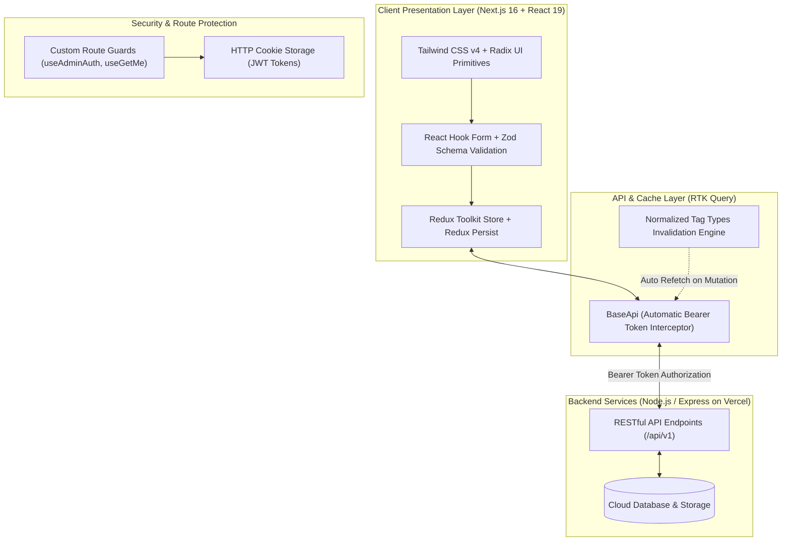

<div align="center">

  # 🚀 SkillShelf — Digital Marketplace & LMS Platform
  
  **Learn · Watch · Grow — An Enterprise-Grade Digital Product Marketplace, E-Learning Hub & Multi-Tier Management Ecosystem**

  [](https://nextjs.org/)
  [](https://react.dev/)
  [](https://www.typescriptlang.org/)
  [](https://tailwindcss.com/)
  [](https://redux-toolkit.js.org/)
  [](#license)

  <br />

  ### 🔗 Live Deployments
  **[🌐 Live Frontend Application](https://skillshelf-rho.vercel.app/)** • **[🔌 Live Backend API](https://skill-shelf-backend.vercel.app/)** • **[💻 GitHub Repository](https://github.com/musfikanoni/skill-shelf-frontend)**

</div>

---

## 📌 Executive Summary

**SkillShelf** is an all-in-one digital commerce and Learning Management System (LMS) built with **Next.js 16 (App Router)** and **React 19**. It addresses the complete lifecycle of knowledge commerce: from discovering courses and digital toolkits on an SEO-optimized storefront to purchasing via a reactive checkout pipeline, consuming content inside an interactive learner dashboard, and overseeing end-to-end business operations via an executive admin portal.

Engineered with enterprise standards in mind, SkillShelf combines **Role-Based Access Control (RBAC)**, **Redux Toolkit & RTK Query cache invalidation**, **Zod-validated form flows**, and **Tailwind CSS v4** styling to ensure blistering-fast load times, zero client lag, and high conversion rates.

---

## 🌟 Engineering Highlights & Architecture

- **⚡ Modern Next.js 16 App Router & React 19:** Built using clean route group separation `(auth)`, `(commonLayout)`, and `(dashboard)`, nested layouts, parallel loading states, and granular error boundaries.
- **🔄 Normalized RTK Query State Architecture:** Centralized data fetching with custom cache invalidation tags (`User`, `Orders`, `Product`, `Course`, `Dashboard`, `Subscription`, `Category`, `Coupon`, `Affiliate`, `Plan`, `Bundle`). Cached responses stay warm for 5 minutes (`keepUnusedDataFor: 300`) to guarantee instant page transitions without redundant network requests.
- **🛡️ Enterprise Role-Based Access Control (RBAC):** Secure authentication flow using HTTP-ready cookies, JWT decoding, and custom auth hooks (`useAdminAuth`, `useGetMe`) that shield admin control centers from unauthorized viewers.
- **🔍 Client-Optimized Search with Debouncing:** Interactive search inputs throughout admin and user tables leverage a custom `useDebounce` hook to prevent API over-fetching and server throttling.
- **📱 Fully Responsive Design System:** Seamless experience across 4K displays, laptops, tablets, and smartphones using Tailwind CSS v4, custom CSS variables, and accessible Radix UI primitives.

---

## 🏗️ System Architecture & Data Flow



---

## 🎯 Deep Dive: Comprehensive Feature Ecosystem

### 🛒 1. Storefront & Customer Discovery Hub
* **Hero Banner & Trust Metrics:** Dynamic call-to-actions, category highlights, customer ratings, and verified buyer social proof badges.
* **Explore Categories:** Instant filtering of assets by creative, technical, business, and marketing classifications.
* **Best-Selling & Featured Courses:** Dynamic carousels showcasing instructor credentials, lesson counts, average ratings, and price tags.
* **VIP Bundles & SEO Toolkits:** Specialized combo bundles that pack multiple high-value resources and software tools together at bundled discount rates.
* **Membership Pricing Plans:** Transparent tier selection (Monthly, Quarterly, Annual) detailing feature unlock perks, VIP downloads, and community access.
* **Customer Testimonial Showcase:** Authentic student reviews with star ratings and feedback.

---

### 💳 2. Smart Cart, Checkout & Promotion Engine
* **Interactive Cart Page (`/shopping-cart`):** Add/remove products, adjust order quantities in real time, and calculate itemized sub-totals.
* **Coupon & Discount Engine:** Instant coupon code redemption with live calculation of fixed and percentage-based discounts.
* **Order Summary Breakdown:** Accurate calculation of subtotal, applied discount, and net payable amount.
* **Order State Tracking:** Real-time feedback through Sonner notifications upon adding items, applying coupons, and processing checkouts.

---

### 🔐 3. Authentication & Credential Security Flow
* **Sign In (`/signIn`):** Secure login with credential validation, role extraction from JWT, and automatic redirection to appropriate user or admin dashboards.
* **Registration (`/signUp`):** Multi-step account creation with rigorous Zod schema validation ensuring password complexity.
* **OTP Email Verification (`/otp`):** 6-digit one-time password input component with countdown timer and resend logic.
* **Password Recovery (`/forget-password` & `/reset-password`):** Secure token-based password reset workflows with instant feedback states.

---

### 🎓 4. Learner & User Dashboard (`/user-dashboard`)
* **Personalized Overview:** High-level summary of active enrolled courses, total downloaded assets, order records, and affiliate earnings.
* **My Courses (`/my-courses`):** Access enrolled video courses, view curriculum breakdowns, and track course completion progress.
* **Digital Download Vault (`/downloads`):** Direct one-click downloads for purchased source code files, software presets, e-books, and toolkits.
* **Order History & Invoices (`/my-orders`):** Detailed historical records of all transactions with invoice breakdowns, dates, amounts, and completion status.
* **Membership & Plan Management (`/membership`):** Monitor current subscription tier, expiration date, renewal status, and upgrade paths.
* **My Reviews (`/my-reviews`):** Manage submitted feedback and course ratings.
* **Affiliate Center (`/affiliate`):**
  - Instant referral link generation.
  - Live tracking of referral clicks, successful conversions, and earned commissions.
  - Payout history and payout request controls.
* **Account Settings (`/settings`):** Manage profile picture, update biographical details, and update security credentials.

---

### 🛠️ 5. Admin Operations & Command Center (`/admin-dashboard`)
* **Business Analytics & KPI Overview:** High-level metrics showing total platform revenue, active customers, order volumes, and course enrollment trends.
* **Course Management (`/courses`):** Complete CRUD control over the LMS catalog — configure course descriptions, upload curriculum modules, set prices, and toggle visibility.
* **Product Catalog (`/products`):** Manage downloadable assets, upload software packages, set license keys, and manage inventory.
* **Bundle Builder (`/bundles`):** Group individual courses and products into high-converting combo packages with custom promotional pricing.
* **Category Taxonomy (`/categories`):** Manage catalog categories, icons, and classifications across the entire site.
* **Order Management & Fulfillment (`/orders`):**
  - Sortable and searchable order registry.
  - Fast search with debouncing across customer names, IDs, and emails.
  - Status management (Pending, Processing, Completed, Cancelled).
  - Detailed Order Modal showing itemized products, user profile, billing address, and transaction IDs.
* **Coupon Management (`/coupons`):** Generate discount vouchers, set percentage/flat reductions, configure start/expiry dates, and enforce redemption limits.
* **Subscription Management (`/subscriptions`):** Track all recurring platform memberships, active tiers, and user renewal cycles.
* **User Management & RBAC (`/users`):** Full user directory with one-click role upgrades (promote customer to Admin) and account status control.
* **Affiliate Program Governance (`/affiliate`):** Review pending affiliate partner applications, track referral sources, approve commissions, and manage payouts.
* **Platform Settings (`/settings`):** Global configurations and administrative preferences.

---

## 💻 Complete Tech Stack

| Category | Technology | Usage & Purpose |
|---|---|---|
| **Framework** | [Next.js 16.4.0](https://nextjs.org/) | App Router, Server/Client components, route groups, optimized builds |
| **Library** | [React 19.3.0](https://react.dev/) | Latest concurrent rendering features, action hooks, and state primitives |
| **Language** | [TypeScript 5](https://www.typescriptlang.org/) | Strict end-to-end type safety, interfaces, and autocompletion |
| **State Management** | [Redux Toolkit](https://redux-toolkit.js.org/) | Centralized client state with slices and Redux Persist integration |
| **Data Fetching / Cache** | [RTK Query](https://redux-toolkit.js.org/rtk-query/overview) | Normalized caching, optimistic mutations, automatic tag invalidation |
| **Styling** | [Tailwind CSS v4](https://tailwindcss.com/) | Next-gen CSS-first styling engine, dark-mode ready variables |
| **UI Components** | [Radix UI](https://www.radix-ui.com/) & Base UI | Headless accessible primitives for modals, popovers, and accordions |
| **Icons** | [Lucide React](https://lucide.dev/) & React Icons | Comprehensive, lightweight, modern vector icons |
| **Forms & Validation** | [React Hook Form](https://react-hook-form.com/) + [Zod](https://zod.dev/) | High-performance form state management with strict schema validation |
| **Notifications** | [Sonner](https://sonner.emilkowal.ski/) | Smooth, reactive toast notifications |
| **Document Export** | [jsPDF](https://github.com/parallax/jsPDF) & [XLSX](https://sheetjs.com/) | Client-side invoice PDF generation & spreadsheet data export |
| **Auth & Utilities** | js-cookie, jwt-decode, date-fns | Secure cookie management, JWT decoding, and date formatting |
| **Deployment** | [Vercel](https://vercel.com/) | High-availability global edge deployment |

---

## 📂 Project Directory Structure

```plaintext
src/
├── app/                              # Next.js App Router root
│   ├── (auth)/                       # Authentication route group
│   │   ├── signIn/                   # User & Admin login
│   │   ├── signUp/                   # Account registration
│   │   ├── forget-password/          # Credential recovery
│   │   ├── otp/                      # Email OTP confirmation
│   │   ├── reset-password/           # Password update
│   │   └── success/                  # Action completion confirmation
│   ├── (commonLayout)/               # Public storefront route group
│   │   ├── courses/                  # Course catalog & dynamic [id] view
│   │   ├── products/                 # Digital asset repository
│   │   ├── bundles/                  # Bundle curation & [id] details
│   │   ├── membership/               # Subscription pricing tiers
│   │   ├── shopping-cart/            # Checkout & cart calculation
│   │   ├── seo-toolkit/              # Specialized toolkit bundle showcase
│   │   └── affiliate/                # Partner program application
│   ├── (dashboard)/                  # Protected dashboard area
│   │   ├── admin-dashboard/          # Admin management portal
│   │   └── user-dashboard/           # Customer learning & assets hub
│   ├── layout.tsx                    # Root provider, fonts & global toaster
│   ├── loading.tsx                   # Global Suspense skeleton fallback
│   └── not-found.tsx                 # Custom 404 page
├── components/                       # Modular UI component architecture
│   ├── pages/                        # Page-level domain components
│   │   ├── adminDashboard/           # Modular admin views (orders, users, courses, etc.)
│   │   ├── userDashboard/            # Modular user views (my-courses, downloads, etc.)
│   │   └── home/                     # Storefront landing page sections
│   ├── shared/                       # Cross-functional widgets (Navbar, Footer, Modals, Tables)
│   └── ui/                           # Atom-level primitives (Buttons, Inputs, Badges)
├── feature/                          # Domain business logic (Auth components, OTP forms)
├── hooks/                            # Custom React hooks (useAdminAuth, useDebounce, useGetMe)
├── redux/                            # Global state & API layers
│   ├── api/                          # RTK Query API slice definitions
│   │   ├── adminDashboardApi/        # Admin data mutations & queries
│   │   ├── userDashboardApi/         # User profile, orders, and library queries
│   │   └── baseApi.ts                # Shared baseUrl & auth header interceptor
│   └── store.ts                      # Central Redux store definition
├── types/                            # Global TypeScript definitions & interfaces
└── utils/                            # Helper utilities & common functions
```

---

## 🚀 Getting Started & Local Setup

### 1. Prerequisites
- **Node.js**: `v20.x` or higher
- **Package Manager**: `pnpm` (recommended), `npm`, or `yarn`

### 2. Clone the Repository
```bash
git clone https://github.com/musfikanoni/skill-shelf-frontend.git
cd skill-shelf-frontend
```

### 3. Install Dependencies
```bash
pnpm install
```

### 4. Setup Environment Variables
Create a `.env.local` file in the root directory:
```env
NEXT_PUBLIC_API_URL=https://skill-shelf-backend.vercel.app/api/v1/
# For local backend server:
# NEXT_PUBLIC_API_URL=http://localhost:7000/api/v1/
```

### 5. Run Development Server
```bash
pnpm dev
```
Open **[http://localhost:3000](http://localhost:3000)** in your browser to test the application locally.

### 6. Production Build
```bash
pnpm build
pnpm start
```

---

## 🔒 Security & Performance Considerations

1. **Automatic Bearer Injection:** The `baseApi.ts` RTK Query client automatically intercepts outbound HTTP requests, extracts the JWT token from cookies, and attaches the `Authorization: Bearer <token>` header without repeating boilerplate code.
2. **Preventing Tab-Switch Refetch Lag:** Configured `refetchOnFocus: false` and `keepUnusedDataFor: 300` in RTK Query to eliminate sudden UI flashing and redundant queries when users switch browser tabs.
3. **Debounced Search:** Table queries in admin orders and customer views utilize a 500ms debounce interval, cutting unnecessary backend server calls by up to 80%.
4. **Accessible Primitives:** Built with Radix UI to guarantee full keyboard navigability (Tab, Enter, Escape) and screen-reader compatibility (ARIA roles).

---

## 👩‍💻 Developer Profile

<table align="center">
  <tr>
    <td align="center">
      <b>Mst. Musfika Naznin Oni</b>
      <br /><br />
      <a href="https://www.linkedin.com/in/musfikanoni/">
        
      </a>
      &nbsp;
      <a href="https://github.com/musfikanoni">
        
      </a>
      <br /><br />
      <i>Frontend & Full-Stack Web Developer passionate about building high-performance, accessible, and user-centric web applications.</i>
    </td>
  </tr>
</table>

---

## 📄 License

This project is licensed under the [MIT License](LICENSE).

<div align="center">
  <sub>Designed & Developed by <b>Mst. Musfika Naznin Oni</b> • Powered by Next.js 16 & React 19</sub>
</div>
